# ThoraxScan Complete App Flow

ThoraxScan is an educational LMS for Radiologic Technology students. The app connects professor-authored chest X-ray learning activities with student analysis, local AI inference, attention heatmaps, and review feedback.

## Editable diagram

[Open the ThoraxScan Complete App Flow in FigJam](https://www.figma.com/board/2KCoYH1QGq9VsHBbpOHxza?utm_source=other&utm_content=edit_in_figjam&oai_id=v1%2FvVy6f7DstwDMtgKfjhHmEK89DBsguox4E3PxWsy9y9w9l7o2m5eRi3&request_id=bcb401bd-44dd-46fc-b927-e78a55770f8f)

## Flow summary

1. A user enters through the landing page and acknowledges the educational disclaimer.
2. New users register; existing users sign in.
3. Password recovery supports forgot password, OTP verification, and password reset.
4. Successful credentials route the user to the student or professor experience.
5. Professors create, configure, preview, and publish guided X-ray activities.
6. Students open assigned activities, provide or select a chest X-ray, and run local SqueezeViT inference.
7. Students review the attention heatmap, write an interpretation, submit the attempt, and receive AI-assisted feedback.
8. Professors review student attempts, inspect responses and heatmaps, provide feedback, and monitor class progress.
9. Both roles can manage profile, display, privacy, and data settings before saving changes or logging out.

## Role-based flow

### Student

- Open the student dashboard.
- Browse assigned activities and enter an activity detail view.
- Select or upload a chest X-ray.
- Validate the image before analysis.
- Run SqueezeViT locally through ONNX Runtime Web.
- Inspect the attention heatmap and use Learning Mode to interpret the image.
- Write and revise an interpretation response.
- Submit the attempt.
- Review AI-assisted feedback and saved attention maps.
- Return to the dashboard to continue learning.

### Professor

- Open the professor dashboard.
- View the student roster and individual student details.
- Manage activities.
- Create an activity with an X-ray case, instructions, and rubric.
- Preview the activity.
- Edit it if it is not ready; otherwise publish it.
- Make the new activity available to students.
- Review student submissions and open individual attempts.
- Inspect the student response and attention heatmap.
- Provide professor feedback.
- Monitor class progress and analytics.

### Shared account and settings

- Open Settings from either role's dashboard.
- Manage Profile.
- Manage Display preferences.
- Review Privacy and Data controls.
- Save changes.
- Log out and return to the signed-out state.

## Mermaid source

```mermaid
flowchart LR
    landing(["Landing | 473:1183"])
    disclaimer["Educational disclaimer"]
    accountChoice{"Account status?"}
    register["Create account | 485:1025"]
    confirmAccount[["Confirm registration"]]
    signIn[["Sign in | 651:882"]]
    forgot["Forgot password | 560:777"]
    otp["Verify OTP | 653:797"]
    reset["Reset password | 653:811"]
    roleCheck{"Credentials identify role?"}
    signedOut(["Signed out"])

    subgraph studentFlow["Student side frames"]
        direction TB
        studentDash(["Student dashboard | 473:514"])
        assigned["Assigned activities | 498:1412"]
        activityDetails["Activity details | 473:580"]
        xrayInput[/Select or upload chest X-ray/]
        validImage{"Valid image?"}
        localInference[["Run SqueezeViT locally"]]
        heatmap["Attention heatmap | 657:1222"]
        response["Interpretation response | 473:633"]
        submitChoice{"Submit attempt?"}
        studentFeedback["AI-assisted feedback"]
        savedMaps["Review attention maps | 473:834"]
        learningMode["Learning mode"]
    end

    subgraph professorFlow["Professor side frames"]
        direction TB
        professorDash(["Professor dashboard | 651:852"])
        roster["Student roster | 667:960"]
        studentDetail["Student detail | 667:971"]
        activityManagement["Activity management | 667:982"]
        builder["Create activity | 678:1015"]
        caseSetup["X-ray case setup | 681:1448"]
        rubric["Instructions and rubric | 681:1577"]
        preview["Preview activity | 681:1754"]
        publishChoice{"Ready to publish?"}
        publish["Publish activity | 684:1934"]
        submissions["Submission review | 684:2126"]
        attemptReview["Open student attempt"]
        heatmapReview["Review response and heatmap"]
        professorFeedback["Professor feedback"]
        classProgress["Class progress and analytics | 684:2268"]
    end

    subgraph settingsFlow["Shared account and settings"]
        direction TB
        settingsHub["Settings | 473:834"]
        profile["Profile | 473:914"]
        display["Display preferences | 473:1045"]
        privacy["Privacy and data | 473:981"]
        saveChanges["Save changes"]
        logout(["Logout"])
    end

    landing -.-> disclaimer
    landing --> accountChoice
    accountChoice -->|"New user"| register
    accountChoice -->|"Existing user"| signIn
    register --> confirmAccount
    confirmAccount --> signIn
    signIn -->|"Use recovery"| forgot
    forgot --> otp
    otp --> reset
    reset --> signIn
    signIn --> roleCheck
    roleCheck -->|"Invalid credentials"| signIn
    roleCheck -->|"Student"| studentDash
    roleCheck -->|"Professor"| professorDash

    studentDash --> assigned
    studentDash --> learningMode
    studentDash --> savedMaps
    assigned --> activityDetails
    activityDetails --> xrayInput
    xrayInput --> validImage
    validImage -->|"No"| xrayInput
    validImage -->|"Yes"| localInference
    localInference --> heatmap
    heatmap --> response
    response --> submitChoice
    submitChoice -->|"Keep practicing"| response
    submitChoice -->|"Submit"| studentFeedback
    studentFeedback --> studentDash
    savedMaps --> heatmap
    learningMode --> assigned

    professorDash --> roster
    roster --> studentDetail
    professorDash --> activityManagement
    activityManagement --> builder
    builder --> caseSetup
    builder --> rubric
    caseSetup --> preview
    rubric --> preview
    preview --> publishChoice
    publishChoice -->|"Needs edits"| builder
    publishChoice -->|"Publish"| publish
    publish -.->|"New activity"| assigned
    professorDash --> submissions
    submissions --> attemptReview
    attemptReview --> heatmapReview
    heatmapReview --> professorFeedback
    professorFeedback -.->|"Feedback available"| studentFeedback
    professorDash --> classProgress
    classProgress -.->|"Monitor learning"| studentDetail

    studentDash --> settingsHub
    professorDash --> settingsHub
    settingsHub --> profile
    settingsHub --> display
    settingsHub --> privacy
    profile --> saveChanges
    display --> saveChanges
    privacy --> saveChanges
    saveChanges --> settingsHub
    settingsHub --> logout
    logout --> signedOut

    style landing fill:#C2E5FF,stroke:#3DADFF
    style disclaimer fill:#FFECBD,stroke:#FFC943
    style accountChoice fill:#FFECBD,stroke:#FFC943
    style roleCheck fill:#FFECBD,stroke:#FFC943
    style validImage fill:#FFECBD,stroke:#FFC943
    style submitChoice fill:#FFECBD,stroke:#FFC943
    style publishChoice fill:#FFECBD,stroke:#FFC943
    style studentFlow fill:#C2E5FF,stroke:#3DADFF
    style professorFlow fill:#DCCCFF,stroke:#874FFF
    style settingsFlow fill:#D9D9D9,stroke:#B3B3B3
    style localInference fill:#C6FAF6,stroke:#5AD8CC
    style heatmap fill:#C6FAF6,stroke:#5AD8CC
    style studentFeedback fill:#CDF4D3,stroke:#66D575
    style professorFeedback fill:#CDF4D3,stroke:#66D575
    style publish fill:#CDF4D3,stroke:#66D575
    style privacy fill:#C6FAF6,stroke:#5AD8CC
    style signedOut fill:#FFCDC2,stroke:#FF7556
```

## Frame references

### Student-side frames

- Landing: `473:1183`
- Registration: `485:1025`
- Student login: `651:882`
- Password recovery: `560:777`, `653:797`, `653:811`
- Student workspace and learning screens: `473:514`, `498:1412`, `473:580`, `657:1091`, `657:1222`, `473:633`, `473:834`
- Settings screens: `473:914`, `473:1045`, `473:981`

### Professor-side frames

- Professor workspace: `651:852`
- Student and activity management: `667:960`, `667:971`, `667:982`
- Activity authoring: `678:1015`, `681:1448`, `681:1577`, `681:1754`
- Publishing, submissions, and analytics: `684:1934`, `684:2126`, `684:2268`

The exact title of some linked frames was not exposed by the design context, so those screens are represented by their role and Figma node ID.
